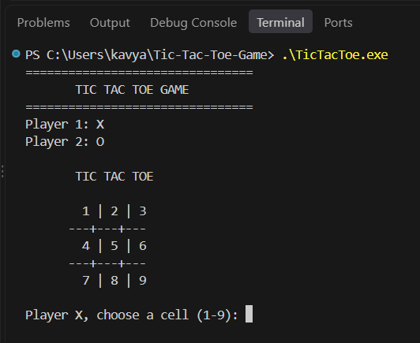

# Tic Tac Toe Game

A console-based Tic Tac Toe game developed in C++ to demonstrate fundamental programming concepts through interactive two-player gameplay.


## Overview

This project implements the classic Tic Tac Toe game on a 3 × 3 board. Two players take turns marking cells with X and O. The game detects winning combinations, handles draws, validates moves, and allows players to start another match.

## Features

- Interactive 3 × 3 game board
- Two-player gameplay
- Dynamic board updates after every move
- Input validation for cell positions
- Prevention of moves on occupied cells
- Automatic win detection for rows, columns, and diagonals
- Draw detection when the board is full
- Replay option after each game

## Technologies Used

- C++
- Arrays
- Loops and Conditional Statements
- Functions
- String Streams
- Input Validation

## Project Structure

```text
Tic-Tac-Toe-Game/
│
├── TicTacToe.cpp
├── README.md
├── .gitignore
├── LICENSE
└── demo3.png
```

## Demo



The game displays the board in the terminal and prompts each player to select a cell numbered from 1 to 9.

## How to Run

### 1. Clone the Repository

```bash
git clone https://github.com/KavyanshGarg/Tic-Tac-Toe-Game.git
```

### 2. Open the Project

Open the cloned project folder in Visual Studio Code.

### 3. Compile the Program

Make sure a C++ compiler such as GCC is installed.

```bash
g++ TicTacToe.cpp -std=c++17 -o TicTacToe
```

### 4. Run the Game

**Windows PowerShell:**

```powershell
.\TicTacToe.exe
```

**Linux/macOS:**

```bash
./TicTacToe
```

## How to Play

1. Player X starts the game.
2. Player O takes the next turn.
3. Enter a number from 1 to 9 to select a cell.
4. The game rejects invalid positions and occupied cells.
5. A player wins by completing a row, column, or diagonal.
6. If all nine cells are filled without a winner, the match is a draw.
7. Enter Y to play again or N to exit.

## Concepts Demonstrated

- Array manipulation
- Loops and conditional logic
- Functions and modular programming
- Input validation
- Game state management
- Win and draw detection

## Future Improvements

- Single-player mode against the computer
- Score tracking across matches
- Difficulty levels
- A graphical user interface

## Author

**Kavyansh Garg**

## License

This project is licensed under the MIT License. See the [LICENSE](LICENSE) file for details.